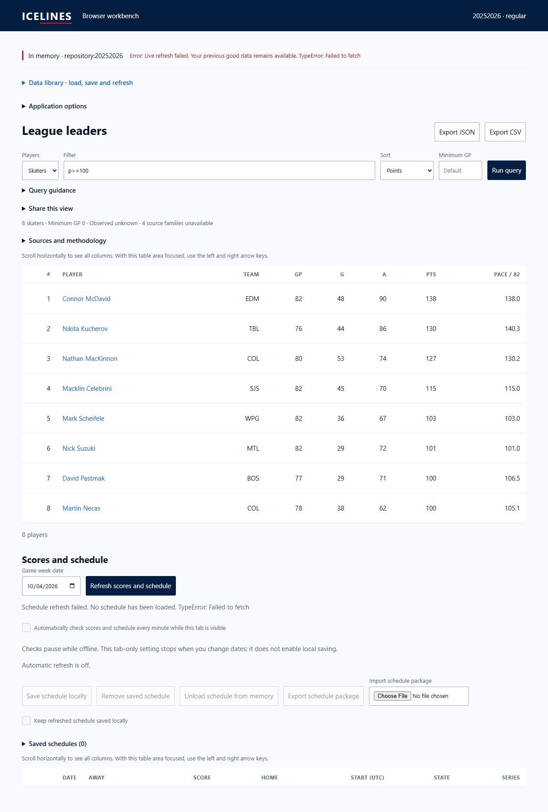
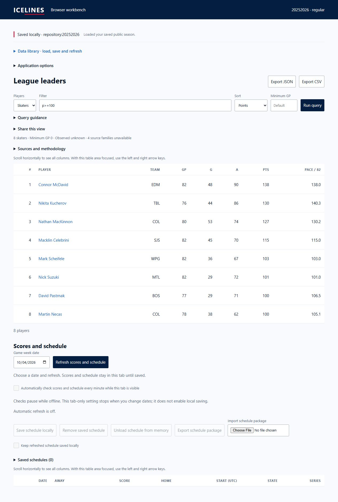

# Static branch validation publication

Date: 2026-10-04. User authorized publishing built static files through the
existing gh-pages branch. No Pages source or environment-policy change occurred.
PR #74 was already merged; both master CI runs passed for d1bbc239.

Verified retained master artifact: 102 files, 75 packages, clean source
`d1bbc239a01749e6cbe0f5ca6a4fdcea5f67ae07`, shell build
`dd80c23b88c9646a4bcd78756ae3007a0a6724eab493f474c61826e65534fed1`.
All staged Git artifact bytes matched before publication. Added only workbench
files to gh-pages commit `1b3b9dfcc6aab2af0e591018ab024e23db2fd996`.
[Pages deployment](https://github.com/giodl73-repo/ICELINES/actions/runs/37239443772)
succeeded. Existing 95 docs files remained unchanged. Root served bytes match
the original Git blob with SHA-256
`83e77bbb606d5375e57dd1eeb893b6db7e2245e21e83e2293148440ad0334c23`;
earlier cb48 hashes refer to the Windows CRLF checkout, not the served blob.

[HTTPS verification](deployed-static-verification.json) matched 24 shell,
worker and manifest files against retained bytes. WASM MIME is application/wasm;
worker MIME is application/javascript. Actual browser at
https://giodl73-repo.github.io/ICELINES/workbench/ loaded 75 catalog entries,
queried 2025–26 regular skaters with p>=100 (8 rows), opened McDavid's player
record, and queried 77 goalies at the shared implicit five-game floor.
Explicit Save locally followed by actual reload reported the restored saved
public season; a fresh filter query returned the same 8 rows.

Direct stats and schedule refresh both failed with TypeError: Failed to fetch.
Stats retained identical prior query rows and was not automatically saved.
Schedule remained unloaded. [Native Origin-header diagnostics](deployed-upstream-diagnostics.json)
returned 403 for initial skater bios/summary and schedule requests. They do not
establish browser request success or isolate CORS as the sole cause. No relay
was implemented. Host/account and operating owner were requested after these
deployed-origin tests, respecting the user's deferred hosting decision.

This is a static validation publication, not completed release acceptance.
Live refresh remains failed; relay-host upstream feasibility, physical mobile/
assistive behavior, full peak-memory, deployed offline/update/rollback and the
remaining lifecycle scenarios require evidence. No native dirty work was changed.

## Follow-up CORS diagnosis

Controlled requests with a browser User-Agent returned 200 JSON for the fixed
bios, summary and schedule endpoints. The GitHub Pages Origin received no
Access-Control-Allow-Origin header. The same stats summary request with
https://www.nhl.com Origin received Access-Control-Allow-Origin for that origin.
Thus CORS prevents our browser from reading these responses; earlier diagnostic
403s do not establish an inaccessible feed. Server-side native success still does
not prove feasibility from a selected relay host; that check remains required.
Raw evidence: `deployed-cors-diagnosis.json` and `deployed-cors-extra-diagnosis.json`
in the wave pulses directory. The published static engine and saved-data behavior
remain usable; the full live release requirement remains open.
