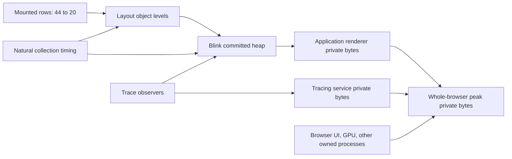

Hypothesis: reducing off-screen rows reduces layout allocations, which lowers
retained native heap capacity and ultimately whole-browser peak private bytes.

The optional discover-causal skill stub was read; its referenced full runbook is
missing from the installed skill tree. This is a direct evidence review, not a
claim that an unavailable prescribed workflow ran.

| Link | Evidence | Disposition |
|---|---|---|
| Buffer to mounted rows | Same complete933-player browser test measures20 versus44; exports/traversal unchanged. | Verified scoped presentation change. |
| Buffer to native object levels | Named class/heap counters at nine checkpoints; no forced collection. | Observed levels, not allocation-rate or reachability proof. |
| Buffer to committed Blink heap | Sampled maxima25.3204 versus31.5080 MiB in one diagnostic pair. | Narrow subsystem difference; no independent replication. |
| Heap to renderer private bytes | After20,131.45 versus132.98 MiB; samples are not simultaneous with native dumps. | No one-for-one byte mapping proved. |
| Renderer to whole-browser acceptance | Original normal pairs387.53/394.69 and394.41/392.97 MiB candidate/control, with baseline variation. | No repeatable whole-browser saving;250 MiB remains failed. |

The diagnostic whole-browser comparison is confounded by its tracing service:
30.79 versus12.90 MiB at after20. That process must not be described as normal app
overhead or subtracted to create an acceptance pass. The original benchmark and
all failed observations remain unchanged.

Next experiments must name a retained component and test the last causal link
with original full workload and repeated OS measurements. DOM count reductions
or class byte totals alone are insufficient. This review neither proves the
target impossible nor changes it. Android remains deferred and untested.

Raw diagnostics, all eighteen traces, GUID joins, field-level summaries, original
normal benchmark reports/samples and scope are in
`context/waves/2026-10-03-browser-wasm/evidence/buffer-heap-bridge-20261017-decision.json`.
